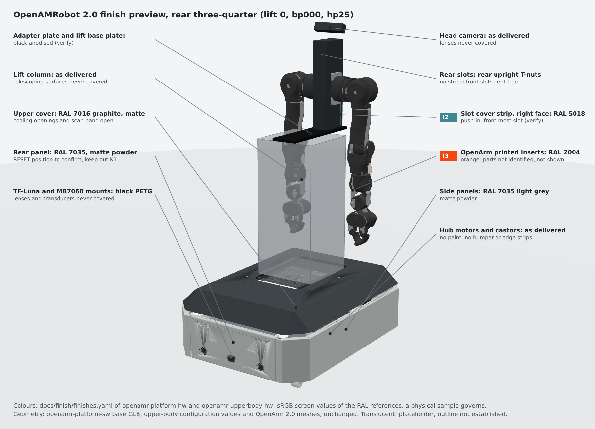

# Finish and trim plan, upper body (OpenAMRobot 2.0 prototype)

> **Status:** proposal for the 2.0 prototype, cosmetic only. Nothing here changes the shape, dimensions,
> position, function or material of any part, the option B design values, the BOM quantities or the
> decisions register. Items marked **verify** name the drawing, measurement or confirmation they need.
> The work-package owner adopts, adapts or rejects this plan.

This folder covers the parts owned by this repository: the lift base plate, the lift column, the
adapter plate and rear upright, the HFS6-60120 arm profile and its slot covers, the OpenArm 2.0 parts
(including any printed parts) and the head camera bracket. The mobile base is covered by the same set
of files in [openamr-platform-hw `docs/finish/`](https://github.com/openAMRobot/openamr-platform-hw/tree/main/docs/finish).
Both `finishes.yaml` files use one schema, one palette and unique ids, so the robot model can read both.

| File | Content |
|---|---|
| [finish-schedule.md](finish-schedule.md) | One row per part or surface: part number, node id or URDF link, location, material and current finish, proposed colour, process, masking and assembly notes |
| [insert-schedule.md](insert-schedule.md) | Inserts I1 to I3 with size, material, attachment, removal and fit checks; arm profile slot use; keep-out rules |
| [finishes.yaml](finishes.yaml) | Machine-readable map from node id or link name to colour (RAL and sRGB), finish and status; the single source for the model |
| [masking-and-assembly.md](masking-and-assembly.md) | Which parts are finished before assembly, what is protected, in which order |
| [feasibility.md](feasibility.md) | Now, needs CAD confirmation, needs supplier confirmation, needs a fit check |
| [renders/](renders/) | Annotated preview renders of the whole robot with the colours of both files (same images as in openamr-platform-hw) |
| [tools/](tools/) | Table generator and checker, preview scene builder and renderer (identical in both repositories) |

## Previews

Front three-quarter and rear three-quarter, lift at 0, base plate position `bp000`, head pitch `hp25`.
Translucent parts are placeholders where the model has no geometry yet: the lift column (only its
240 mm fore-aft side is established) and the lift base plate (outline pending; drawn as the
300 x 190 mm bolt pattern plus 10 mm). The rear upright, the J1_A spacers and the head camera bracket
are not drawn.




## Design direction

Restrained and engineering-led. The arm profile is graphite and the plates are black; the only
accents on the whole robot are two cyan slot cover strips (I1, I2) and orange OpenArm printed inserts
(I3) once the printed parts are identified.

| Role | Colour | RAL | sRGB (screen) | Where on the upper body |
|---|---|---|---|---|
| Body panels | light grey | RAL 7035 | `#CBD0CC` | none (mobile base) |
| Arm profile | graphite | RAL 7016 target | `#383E42` | HFS6-60120, dark anodised if offered (verify) |
| Plates, bracket, small parts | black | RAL 9005 appearance | `#0A0A0A` | lift base plate, adapter plate, rear upright (anodised); head camera bracket; cable guards |
| Accent 1 | orange | RAL 2004 | `#F44611` | I3, OpenArm printed inserts (verify) |
| Accent 2 | cyan | RAL 5018 (verify against a physical sample) | `#3F888F` | I1, I2, slot cover strips |
| As delivered | none | none | model materials | DOLD column, OpenArm metal parts and actuators, ZED Mini, supplied camera mount, chest E-stop |

sRGB values are screen approximations for the model and the renders; a physical RAL sample governs.
Anodised colours are not RAL controlled; the RAL is an appearance reference.

## Process by material

| Material | Process | Parts |
|---|---|---|
| Aluminium plate 6082-T6, 10 mm | black anodise after machining; bonding points masked or spot-faced | lift base plate, adapter plate, rear upright if aluminium |
| Aluminium extrusion HFS6-60120 | ordered with a dark anodised finish if the manufacturer offers it, otherwise as delivered; never painted or wrapped | arm profile |
| Plastic slot cover strip | coloured in the material (extruded PVC or PP, or printed TPU) | I1, I2 |
| Printed polymer | coloured filament of the same material as the original part | I3 (OpenArm printed parts, once identified); head camera bracket if printed |
| Steel sheet (only if the bracket or upright is steel) | polyester powder RAL 9005 matte | head camera bracket, rear upright |
| Purchased parts | as delivered | DOLD Hexalift V4, OpenArm 2.0 kit, ZED Mini, chest E-stop, fasteners |

## Never finished or covered

Threads, T-slots used for fastening and the end-tapped core holes of the profile; bonding points;
clamped mating faces (column foot and top plate, adapter plate seat); the telescoping sections and
seals of the DOLD column; OpenArm joints, actuators, cables and labels; the ZED Mini lenses and the
in-hand camera windows; cooling paths; safety markings. No rubber edge protectors and no bumper strips.
No inserts, paint or film on the lift column.

## Safety colours (rule K1)

The chest E-stop (S2, OpenArm kit button) stays red on yellow as delivered. No orange or cyan accent
within 150 mm of its bezel edge, measured on the surface, and no accent on the face that carries it.
The same rule protects the base E-stop and the blue RESET button. The chest E-stop position is not in
any source yet (verify); I1, I2 and I3 stay verify until it is known.

## Sources

| Source | Revision used |
|---|---|
| Option B mounting page | `docs/mechanical/upper_body_option_B.md` at `6349ff2` |
| OpenAMRobot 2.0 Detailed Hardware BOM | Issue 7.13 draft, 25 October 2026 (rows MEC-003, MEC-004, MEC-013, MEC-018, ARM-001 to ARM-011). The register entry BOM-ISSUE-IN-FORCE names Issue 7.10; confirm the cited rows against the issue in force |
| Upper-body model | openamr-upperbody-sw `f57e54c`, `openamrobot_upperbody_description` (links, `config/upperbody_configuration.yaml`) |
| Base model part list | openamr-platform-sw `9a58e0b` (#96), `meshes/PROVENANCE.yaml` |
| OpenArm 2.0 | enactic/openarm_description `81fe647` (link names, meshes, Apache-2.0); enactic/openarm `14c1959` (documentation; the published BOM tables list Al6061 and SUS304 parts for 1.0 and PLA for the 1.0 leader end effector); enactic/openarm_hardware `eefc9fa` (CERN-OHL-S-2.0; the 2.0 CAD and BOM are in the Google Drive folder named in its README, not reachable from this work) |
| Arm profile | MISUMI HFS6-60120 product listing (6 series, 8 mm slot, 60 x 120 mm); outline drawing not read |
| Decisions register | openAMRobot/.github `decisions.yaml` at `68ba70b` (LIFT, ARM-MOUNT, HEAD-CAMERA-IDENTITY, MAX-ASSEMBLED-HEIGHT, DATUM-HEIGHT-STACK) |
| E-stop scope | open draft openamr-platform-hw #27 (S2 chest E-stop is the OpenArm kit button) |

## Regenerating the tables and previews

```bash
python3 docs/finish/tools/finish_tables.py docs/finish/finishes.yaml \
  --companion ../openamr-platform-hw/docs/finish/finishes.yaml --write docs/finish/finish-schedule.md
```

The previews are built as described in openamr-platform-hw `docs/finish/README.md`; the scripts in
[tools/](tools/) are the same in both repositories.
